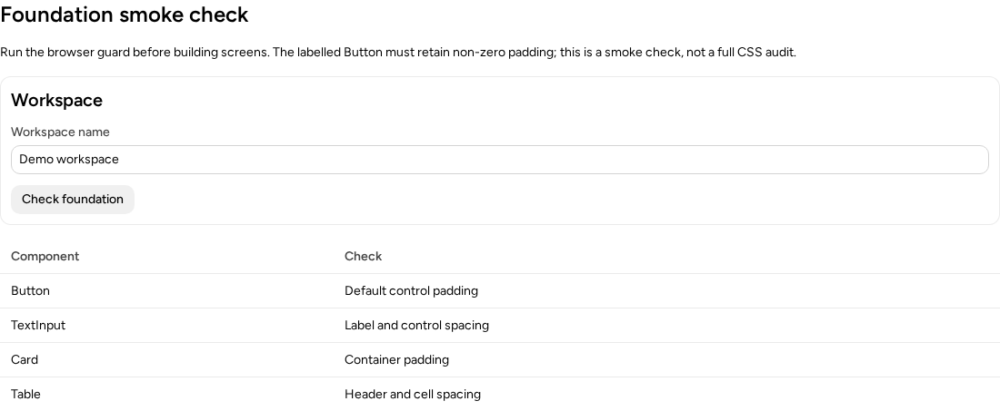
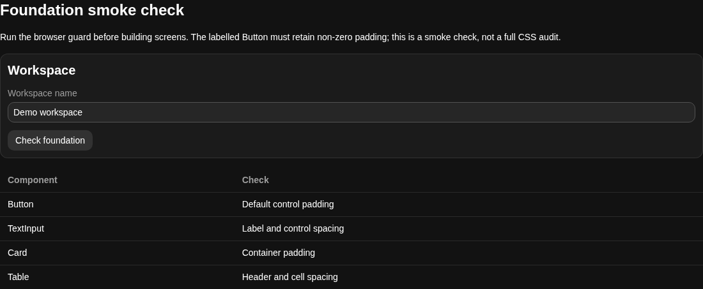
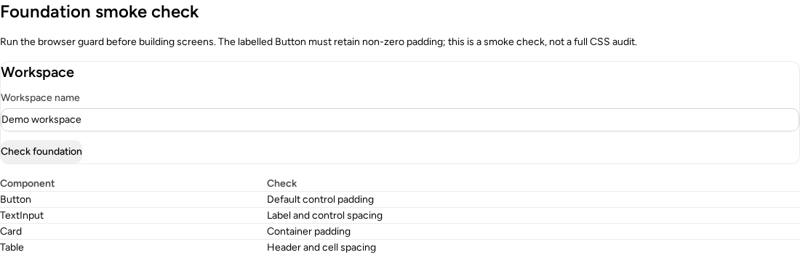

# Foundation adoption workflow — #3755

Implementation: `8eb9c552c0d2994345e49046b14b58fde6958770`
Packed consumer execution: `c1931959e629f095a5ef94d284d0bb61a6062772`
The final revision only adds the generated registry contract entry for this new template. No existing route changed; the consumer code is identical.
Base: `86e83921910a0b29621d072087790d9c1572d3d4`

## Consumer path

The published CLI owns one `FoundationSmoke` scaffold and one `foundation-smoke.mjs` browser check. Sandbox, Storybook and adopting apps use the same composition/check; no duplicate implementation or repository checkout is needed for adopters.

```
astryx template FoundationSmoke src/FoundationSmoke.tsx
npm install --save-dev playwright
npx playwright install chromium
node node_modules/@astryxdesign/cli/assets/checks/foundation-smoke.mjs \
  --url http://localhost:5173/foundation-check/ \
  --output-dir test-results/foundation
```

Mount the scaffold inside the existing app layout and theme, after that app's actual CSS. The setup, migration and Tailwind guides share the canonical layer/import strings. `layers.css` is imported before `globals.css`; resets are lowest, preflight is layered, and utilities follow Astryx/theme styles. The existing migration audit leads directly to this check.

## Real packed-consumer proof

Core, Neutral and CLI tarballs were installed into two isolated Vite projects, not workspace-linked or mocked components. The projects read the recipes from the installed CLI's JSON docs and scaffolded the screen through the installed template command. The installed CLI guard was run against each built app URL.

| Built recipe | Guard exit | Meaning |
| --- | --- | --- |
| Plain CSS, canonical foundation | 0 | Real app retains component padding |
| Plain CSS, reset in `reset` | 0 | Low-layer reset preserves padding |
| Plain CSS, reset in later `components` | 1 | Collapsed padding is rejected |
| Plain CSS, unlayered reset | 1 | Collapsed padding is rejected |
| Tailwind v4, canonical foundation | 0 | Layered preflight preserves padding |
| Tailwind v4, reset in `reset` | 0 | Low-layer reset preserves padding |
| Tailwind v4, reset in later `components` | 1 | Collapsed padding is rejected |
| Tailwind v4, unlayered reset | 1 | Collapsed padding is rejected |
| Tailwind v4, actual preflight imported unlayered | 1 | Collapsed padding is rejected |

These failure cases rebuilt the real stylesheets; they were not only injected styles. Each ordinary negative run failed specifically with `inlineStart: 0px`, not a missing page or browser-loading error. The separate guard self-test also checked injected resets on fresh page loads.

Theme/utility precedence was measured in both light and dark modes, on separate page loads:

| Consumer | Base Button | Authored theme override | Consumer utility |
| --- | --- | --- | --- |
| Plain, light | 12px | 32px | 8px |
| Plain, dark | 12px | 32px | 8px |
| Tailwind, light | 12px | 32px | 8px |
| Tailwind, dark | 12px | 32px | 8px |

The theme used `defineTheme` with a token-backed padding override. The plain utility lived in `utilities`; the Tailwind case used the actual compiled `px-2` utility. This proves the recipes' precedence in real Chromium, not a DOM width stub.

## Pixels

Plain/light, correct:



Tailwind/dark, correct:



Plain CSS with a deliberately misplaced reset:



Computed values and exit codes: [results.json](consumer/results.json).

## Verification

- Workspace build, Sandbox build and Storybook build passed.
- Shared Sandbox and Storybook browser guards passed their positive/negative controls.
- CLI strict `checkJs`, template-doc typecheck, Core and Storybook typechecks passed.
- `pnpm lint:strict` passed.
- Guard, workflow routing, route and doc-discovery tests: 103 passed.
- Offline raw-diff review completed; its strict-typing finding was corrected and verified by the actual strict check.
- Packed consumer matrix above passed after fixing the test runner to invoke its child asynchronously while serving HTTP.

This is a collapsed-padding smoke check, not an exhaustive CSS, accessibility or contrast audit. No Core source, published API, package exports or version fields changed. CLI-only patch changeset. Draft only; never merged.

This branch contains evidence assets only and can be deleted after review.
